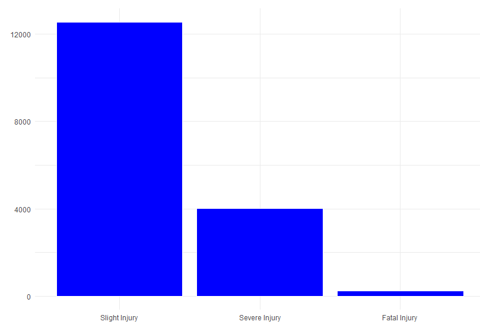
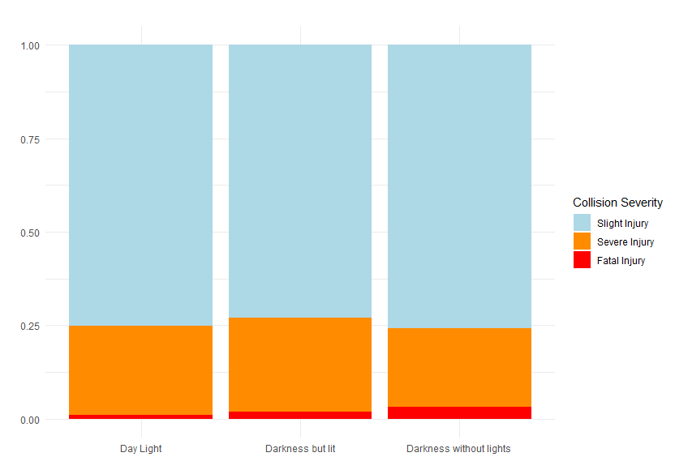
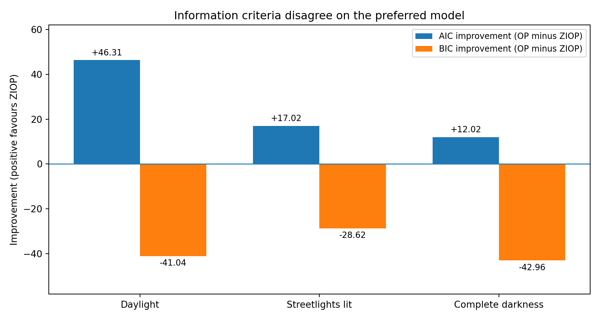

---
title: "When One Outcome Has Two Explanations"
subtitle: "Zero-inflated ordered probit, latent injury processes, and evidence from road collisions"
author: "Ifeanyi Omeife"
description: "A mathematical exploration of zero-inflated ordered probit, with an empirical application to police-recorded single-vehicle injury collisions and an audit of likelihood-based model selection."
categories:
  - Statistical Modelling
  - Ordinal Regression
  - Latent Variables
  - Maximum Likelihood
toc: true
toc-depth: 3
number-sections: true
format:
  html:
    code-fold: false
    fig-align: center
---

*An observed outcome tells us what happened. It does not necessarily tell us which process generated it.*

A common modelling instinct is to take the distribution of an observed response at face value. If a category appears unusually often, perhaps it is simply the most likely outcome of a single process. But there is another possibility: the same observed category might arise from **different unobserved mechanisms**. The distinction matters because those mechanisms could respond differently to the same explanatory variables.

I want to understand how to model that possibility for **ordered outcomes**. I will start with a conventional ordered probit, introduce the zero-inflated ordered probit (ZIOP) as a two-process extension, derive its likelihood, and then take the model into a substantive application: injury severity in police-recorded single-vehicle collisions in Great Britain.

The empirical results in Sections 4–5 come from an earlier analysis of STATS19 injury-collision records (2016–2021). I have condensed the reported results and extracted the original figures. **The model has not been re-estimated for this article**, and I distinguish the original estimates from the theoretical derivations and methodological reflections added here.

## The statistical question: can the same outcome have two causes?

Imagine measuring customer activity in ordered categories: no activity, low activity, moderate activity and high activity. Many customers appear in the first category. One explanation is that the ordered activity process simply places a lot of mass at its lower end. Another is that some customers are effectively unable or unwilling to participate at all, while others could participate but happened not to in the observation window.

Both mechanisms generate the same recorded **zero**, but one represents a distinct state and the other is an ordinary outcome of a variable activity process.

This is the intuition behind a zero-inflated model. The word *zero* is a coding convention: it denotes the category to which the extra probability mass is assigned. It need not mean the literal absence of an event or a numerical count of zero. For an **ordinal** response, the important question is whether there is reason to add an inflated state to the usual ordered-outcome mechanism.

There is a crucial qualification: **observing a high frequency of the lowest category is not proof of a mixture**. A conventional ordered probit can also assign high probabilities to that category. The two-process model is a hypothesis that must earn its additional complexity through estimation, diagnostics and appropriate comparisons.

## Starting with the ordered probit

Let an ordinal response take three values,

$$
Y_i\in\{0,1,2\},
$$

where increasing values represent increasing severity or intensity. The ordered probit posits an unobserved continuous latent variable,

$$
Y_i^*=x_i^\top\beta+\varepsilon_i, \qquad \varepsilon_i\sim N(0,1).
$$

Here $i$ identifies a collision, $x_i$ is its vector of observed characteristics, $\beta$ is the corresponding coefficient vector, and $\varepsilon_i$ is an unobserved disturbance assumed to follow the standard normal distribution. The latent index $Y_i^*$ is **unobserved because STATS19 records an injury category, not an exact continuous severity propensity**. This is distinct from the fact that $\beta$ and the threshold parameters must be estimated. The normality assumption gives us a way to calculate probabilities; it is not what makes the severity propensity unobserved. Two ordered thresholds $\kappa_0<\kappa_1$ connect the latent index to the recorded categories:

$$
Y_i=\begin{cases}
0 & \text{if } Y_i^*\leq\kappa_0,\\
1 & \text{if } \kappa_0<Y_i^*\leq\kappa_1,\\
2 & \text{if }Y_i^*>\kappa_1.
\end{cases}
$$

Write $\eta_i=x_i^\top\beta$ for the fitted latent index (excluding the disturbance) and $\Phi$ for the standard normal cumulative distribution function (CDF). Denote by $q_{ij}$ the ordered-probit probability of category $j\in\{0,1,2\}$ for collision $i$. For example, the middle category corresponds to $\kappa_0<Y_i^*\leq\kappa_1$; therefore its probability is the upper normal CDF minus the lower normal CDF. The three probabilities are

$$
\begin{aligned}
q_{i0}&=\Phi(\kappa_0-\eta_i),\\
q_{i1}&=\Phi(\kappa_1-\eta_i)-\Phi(\kappa_0-\eta_i),\\
q_{i2}&=1-\Phi(\kappa_1-\eta_i).
\end{aligned}
$$

The middle-category probability is the normal CDF at the **upper** threshold minus the CDF at the **lower** threshold. This follows directly from asking how much probability lies between the two boundaries; reversing the subtraction would incorrectly produce a negative probability.

The probabilities are nonnegative and sum to one. The variance of $\varepsilon_i$ is normalised to one to identify the probit scale; the location also requires a normalisation, typically by omitting a free intercept from the latent severity equation if both thresholds are estimated.

A positive coefficient in $\beta$ shifts the **latent severity index**, not an observed probability directly. It generally lowers $q_{i0}$ and raises $q_{i2}$, but its effect on the middle category depends on where the thresholds lie. Hence a coefficient's sign is not a substitute for calculating category-specific marginal effects.

The one-process assumption is apparent here: the same ordered latent mechanism is responsible for **all three** categories. What if part of category zero comes from an additional state?

## Adding a latent process: ZIOP from first principles

The zero-inflated ordered probit model of Harris and Zhao (2007) combines a binary **state-selection** process with an ordered-probit **severity** process. I will use **one state indicator**, $g_i$, throughout:

- $g_i=0$: the **inflated minor-injury state**. The observed response is always $Y_i=0$ (slight injury).
- $g_i=1$: the **ordered state**. The ordered process can generate $Y_i=0,1,2$ (slight, serious, or fatal injury).

This is the same coding as Harris and Zhao's participation indicator $r_i$: $r_i=0$ for their always-zero state and $r_i=1$ for their ordered-response state. Their paper uses **different letters for the two linear predictors**; an explicit correspondence appears below. A *minor-injury state* is a modelled latent mechanism, not a synonym for every collision actually recorded as slight. A collision can enter the ordered state and still be observed with slight injury.

<!-- CORRECTION 1: One state coding throughout, matching Harris and Zhao's r=0/1. -->

### The binary probit: which state generates the observation?

Let $z_i$ be the vector of characteristics used to model state membership, $\gamma$ its coefficient vector, and $u_i$ a standard-normal disturbance. Define an unobserved state propensity $g_i^*$ and the latent-state indicator $g_i$ as follows:

$$
g_i^*=z_i^\top\gamma+u_i,\qquad u_i\sim N(0,1),\qquad
g_i=\mathbf{1}(g_i^*>0).
$$

The state itself is latent: $g_i$ is not recorded in STATS19. The indicator is a modelling device for which process generates the observed outcome. Writing $p_i$ for the probability of the ordered state gives

$$
p_i=P(g_i=1\mid z_i)=\Phi(z_i^\top\gamma).
$$

Consequently, $P(g_i=0\mid z_i)=1-p_i=1-\Phi(z_i^\top\gamma)$ is the inflated-state probability. Here $z_i$ and $\gamma$ belong **only to the binary state equation**; the $x_i$ and $\beta$ defined in Section 2 belong to the ordered-severity equation. The two predictor sets may overlap, but they need not be identical.

### Combining the processes: the synthesis equation

Following Equation (6) of Harris and Zhao (2007), the two states are connected to the observed outcome through multiplication. Let $\widetilde{Y}_i\in\{0,1,2\}$ denote the **categorical** injury outcome generated by the ordered-probit mechanism. It is distinct from the **continuous** latent index $Y_i^*$ introduced in Section 2. The observed ZIOP response is

$$
Y_i=g_i\widetilde{Y}_i.
$$


### Deriving the observed probabilities

Having established the synthesis equation,

$$
Y_i=g_i\widetilde{Y}_i,
$$

we can now derive the probability of observing each injury-severity category.

Recall that $g_i$ is the binary indicator determining which latent process generates the observed injury outcome:

- $g_i=0$ represents the inflated minor-injury state, which always produces $Y_i=0$.
- $g_i=1$ represents the ordered state, which can produce $Y_i=0,1,2$.

The ordered outcome $\widetilde{Y}_i$ is generated by the ordered probit process.

**Let us denote** the probability of entering the ordered state as $p_i$, expressed as

$$
p_i=P(g_i=1\mid z_i)=\Phi(z_i^\top\gamma),
$$

where $z_i$ is the vector of explanatory variables in the binary probit equation, $\gamma$ is the corresponding vector of coefficients, and $\Phi$ denotes the cumulative distribution function of the standard normal distribution.

Consequently, the probability of belonging to the inflated state is

$$
P(g_i=0\mid z_i)=1-p_i.
$$

Next, **let us denote** the conditional probability of observing injury category $j$ within the ordered state as $q_{ij}$:

$$
q_{ij}
=
P(\widetilde{Y}_i=j\mid g_i=1,x_i),
\qquad j\in\{0,1,2\},
$$

where $x_i$ represents the explanatory variables in the ordered probit equation.

For the lowest injury category, this conditional probability becomes

$$
q_{i0}
=
P(\widetilde{Y}_i=0\mid g_i=1,x_i)
=
\Phi(\kappa_0-x_i^\top\beta),
$$

where $\kappa_0$ is the first ordered threshold and $\beta$ is the coefficient vector of the ordered probit equation.

Under the assumption that the disturbances in the binary and ordered processes are independent, the observed probability of a slight injury can now be derived.

**A slight injury can arise from two distinct latent processes:**

1. The collision belongs to the inflated minor-injury state ($g_i=0$).
2. The collision belongs to the ordered state ($g_i=1$), but the ordered process generates a slight injury ($\widetilde{Y}_i=0$).

Since these two events are mutually exclusive, the law of total probability gives

$$
\begin{aligned}
P(Y_i=0\mid x_i,z_i)
&=P(g_i=0\mid z_i)\\
&\quad+P(g_i=1\mid z_i)
P(\widetilde{Y}_i=0\mid g_i=1,x_i)\\
&=(1-p_i)+p_iq_{i0}.
\end{aligned}
$$

The expression contains two components:

- $(1-p_i)$ represents the probability of entering the inflated minor-injury state.
- $p_iq_{i0}$ represents the probability of entering the ordered state and generating a slight injury within that state.

Substituting the definitions of $p_i$ and $q_{i0}$ gives the expanded probability equation:

$$
\begin{aligned}
P(Y_i=0\mid x_i,z_i)
&=[1-\Phi(z_i^\top\gamma)]\\
&\quad+\Phi(z_i^\top\gamma)
\Phi(\kappa_0-x_i^\top\beta).
\end{aligned}
$$

For higher injury-severity categories, the inflated state cannot generate the observed outcome. Therefore, serious and fatal injuries must originate from the ordered process.

The probability of observing injury category $j>0$ is

$$
P(Y_i=j\mid x_i,z_i)
=
p_iq_{ij},
\qquad j\in\{1,2\}.
$$

Using the ordered probit probabilities derived earlier, **let us denote** the overall probability of observing injury category $j$ as

$$
P_{ij}=P(Y_i=j\mid x_i,z_i).
$$

The complete ZIOP probability specification is therefore

$$
\boxed{
\begin{aligned}
P_{i0}
&=(1-p_i)+p_i\Phi(\kappa_0-\eta_i),\\
P_{i1}
&=p_i[\Phi(\kappa_1-\eta_i)-\Phi(\kappa_0-\eta_i)],\\
P_{i2}
&=p_i[1-\Phi(\kappa_1-\eta_i)].
\end{aligned}
}
$$

Here $\eta_i=x_i^\top\beta$ represents the ordered-probit linear predictor, while $\kappa_0$ and $\kappa_1$ are the ordered thresholds, with $\kappa_0<\kappa_1$.

Notice that the probabilities satisfy

$$
P_{i0}+P_{i1}+P_{i2}=1.
$$

This follows because the ordered-probit probabilities sum to one:

$$
q_{i0}+q_{i1}+q_{i2}=1,
$$

and the two latent-state probabilities satisfy

$$
(1-p_i)+p_i=1.
$$

The resulting specification captures the defining characteristic of the Zero-Inflated Ordered Probit model: **the lowest observed injury category can originate from two latent processes, whereas the higher injury categories can only originate from the ordered process.**


### Connecting our notation to Harris and Zhao's Equation (7)

The source of the apparent difference is that Harris and Zhao use $x^\top\beta$ for the **binary state** predictor and $z^\top\gamma$ for the **ordered severity** predictor. In this article those letter assignments are reversed. To avoid using the same symbols for two different roles, the subscript $H$ below means *the notation used by Harris and Zhao*:

| Quantity | This article | Harris and Zhao (2007) |
|:--|:--|:--|
| State indicator | $g_i$ | $r_i$ |
| Binary-state linear predictor | $z_i^\top\gamma$ | $x_H^\top\beta_H$ |
| Ordered-severity linear predictor | $x_i^\top\beta=\eta_i$ | $z_H^\top\gamma_H$ |
| First ordered threshold | $\kappa_0$ | Fixed at $0$ |
| Next ordered threshold | $\kappa_1$ | $\mu_1$ |

In the original paper's threshold normalization, the ordered-state probability of the lowest category is $\Phi(-z_H^\top\gamma_H)$; it is therefore equivalent to our $\Phi(\kappa_0-x_i^\top\beta)$ after accounting for the chosen latent-index location normalization. Similarly, the binary-state probability $\Phi(x_H^\top\beta_H)$ corresponds to our $p_i=\Phi(z_i^\top\gamma)$.

Using **only Harris and Zhao's notation** (identified by $H$), their three-category version of Equation (7) reads

$$
\begin{aligned}
P(Y_i=0)&=[1-\Phi(x_H^\top\beta_H)]
 +\Phi(x_H^\top\beta_H)\Phi(-z_H^\top\gamma_H),\\
P(Y_i=1)&=\Phi(x_H^\top\beta_H)
 [\Phi(\mu_1-z_H^\top\gamma_H)-\Phi(-z_H^\top\gamma_H)],\\
P(Y_i=2)&=\Phi(x_H^\top\beta_H)
 [1-\Phi(\mu_1-z_H^\top\gamma_H)].
\end{aligned}
$$

The original paper fixes its first ordered threshold at zero. Our article instead estimates $\kappa_0$ and $\kappa_1$, while excluding a separate free intercept from the ordered latent equation. These are different **location normalizations**, not different assumptions about the two-state mechanism. Thus the expressions correspond under a consistent reparameterization; we should not substitute $\Phi(x^\top\beta)$ for our $p_i$ without explicitly identifying which paper's $x$ and $\beta$ are intended.

### Can we identify the source of an observed slight injury?

Even after observing $Y_i=0$, its latent source remains unknown. By Bayes' rule, the fitted model assigns the following **posterior probability** that the zero came from the inflated state:

$$
P(g_i=0\mid Y_i=0,x_i,z_i)
=\frac{1-p_i}{(1-p_i)+p_iq_{i0}}.
$$

This is a **model-dependent estimate** of state membership, not external verification of what physically caused a particular collision.

::: {.callout-note title="What about correlated disturbances?"}
The derivations above set $\operatorname{Corr}(u_i,\varepsilon_i)=\rho=0$, corresponding to the independent-error specification discussed in the empirical research. If $\rho\ne0$, evaluating the joint state/severity events requires bivariate-normal probabilities rather than the simple products $p_iq_{ij}$. The standard ordered-category thresholds and latent processes remain conceptually relevant, but the probability expressions must change.
:::

<!-- CORRECTION 4: The remaining likelihood and marginal-effect formulas are unchanged and use the definitions above. -->

### Maximum likelihood estimation

Define $d_{ij}=\mathbf{1}(Y_i=j)$ and let $\theta$ denote the coefficients and ordered thresholds. Assuming independent observations, the log-likelihood is

$$
\boxed{\ell(\theta)=\sum_{i=1}^n\sum_{j=0}^2 d_{ij}\log P_{ij}(\theta).}
$$

An estimator chooses parameters to maximise $\ell(\theta)$ subject to the threshold-ordering and identification constraints. Numerical optimisation is usually necessary; one may enforce $\kappa_1>\kappa_0$ by parameterising $\kappa_1=\kappa_0+\exp(\delta)$.

Here is the computational skeleton of the independent-error likelihood. It shows what is estimated; **it is not a claim that the original 2016–2021 dataset has been refitted here**.

```r
# Inputs: y coded 0/1/2; X = ordered equation matrix (no free intercept),
# Z = splitting-equation matrix; rows correspond to the same observations.
ziop_negloglik <- function(par, X, Z, y) {
  kx <- ncol(X)
  kz <- ncol(Z)
  beta <- par[seq_len(kx)]
  gamma <- par[kx + seq_len(kz)]
  k0 <- par[kx + kz + 1]
  k1 <- k0 + exp(par[kx + kz + 2])

  eta <- drop(X %*% beta)
  p_order <- pnorm(drop(Z %*% gamma))
  q0 <- pnorm(k0 - eta)
  q1 <- pnorm(k1 - eta) - q0
  q2 <- 1 - pnorm(k1 - eta)

  P <- cbind(1 - p_order + p_order*q0,
             p_order*q1,
             p_order*q2)
  selected <- P[cbind(seq_along(y), y + 1L)]
  -sum(log(pmax(selected, 1e-12)))
}

# Example usage after creating X, Z, and y:
# start <- rep(0, ncol(X) + ncol(Z) + 2)
# fit <- optim(start, ziop_negloglik, X=X, Z=Z, y=y,
#              method="BFGS", control=list(maxit=5000))
```

This is deliberately a small educational likelihood function. A full implementation must verify convergence, identification, numerical accuracy of tail probabilities, standard-error calculations and sensitivity to starting values.


### Marginal effects

Marginal effects provide a means of understanding how changes in explanatory variables influence the predicted probability of a particular injury-severity outcome, holding other variables constant.

In the Zero-Inflated Ordered Probit (ZIOP) model, marginal effects can be examined through two components: the binary probit process and the ordered probit process.

The **binary probit marginal effect** measures how a change in an explanatory variable influences the probability of belonging to a particular latent injury state.

Recall that the probability of entering the ordered state is

$$
p_i=P(g_i=1\mid z_i)=\Phi(z_i^\top\gamma).
$$

For a continuous explanatory variable $t$, the marginal effect of entering the ordered state is expressed as

$$
ME_{P(g_i=1)}
=
\frac{\partial P(g_i=1\mid z_i)}{\partial t}
=
\phi(z_i^\top\gamma)\gamma_t.
$$

Here, $\phi$ represents the probability density function of the standard normal distribution, $z_i$ represents the explanatory variables in the binary probit process, and $\gamma_t$ is the coefficient associated with the continuous explanatory variable $t$.

Since the probability of belonging to the inflated state is $P(g_i=0\mid z_i)=1-p_i$, its corresponding marginal effect is

$$
ME_{P(g_i=0)}
=
\frac{\partial P(g_i=0\mid z_i)}{\partial t}
=
-\phi(z_i^\top\gamma)\gamma_t.
$$

The **ordered probit marginal effect** measures how a change in an explanatory variable influences the probability of each ordered injury category, such as slight, serious or fatal injury.

Recall that the ordered probit process is defined by the linear predictor $\eta_i=x_i^\top\beta$, where $x_i$ represents the explanatory variables and $\beta$ denotes their associated coefficients.

Let $q_{ij}$ represent the conditional probability of observing injury category $j$ within the ordered state.

For the ordered model, the marginal effect of a continuous explanatory variable $t$ is expressed as

$$
ME_{q_{ij}}
=
\frac{\partial q_{ij}}{\partial t}
=
\left[
\phi(\kappa_{j-1}-\eta_i)
-
\phi(\kappa_j-\eta_i)
\right]\beta_t.
$$

Here, $\kappa_{j-1}$ and $\kappa_j$ represent the lower and upper thresholds separating injury category $j$, $\eta_i$ represents the ordered probit linear predictor, and $\beta_t$ is the coefficient associated with the explanatory variable $t$.

For the lowest and highest injury categories, the corresponding boundaries are defined as $\kappa_{-1}=-\infty$ and $\kappa_2=+\infty$, with $\phi(-\infty)=\phi(+\infty)=0$.

The expression illustrates how changes in an explanatory variable affect the probability of an injury category through differences in the normal density evaluated at the category thresholds.

A positive coefficient generally decreases the probability of the lowest category and increases the probability of the highest category, while its effect on intermediate categories depends on the thresholds.

#### Marginal effects in the ZIOP model

Following Harris and Zhao (2007), the overall marginal effect of the ZIOP model can be decomposed into two contributions:

1. **Binary probit contribution:** The effect of an explanatory variable on the probability associated with the latent state-selection process.
2. **Ordered probit contribution:** The effect of an explanatory variable on the probability of an injury-severity category within the ordered process.

These contributions are represented through the marginal effects of the binary probability $p_i$ and the conditional ordered probabilities $q_{ij}$.

The **overall marginal effect** combines the binary and ordered probit contributions to describe how a change in an explanatory variable influences the probability of observing a particular injury-severity category.

The original research also considered a correlation parameter $\rho$, representing the correlation between the disturbances in the binary probit and ordered probit processes. In the empirical specification used in this investigation, the disturbances were assumed independent, so $\rho=0$.

#### Marginal effects used in the empirical analysis

Although the ZIOP model permits decomposition of the overall marginal effect into two components, **this investigation focuses on the marginal effect of the ordered probit component** to examine how changes in explanatory variables are associated with changes in the probabilities of slight, serious and fatal injuries.

The marginal effects were evaluated at the mean of the explanatory variables.

This approach was used to interpret how factors such as speed limits, vehicle characteristics and road conditions were associated with different injury-severity outcomes across the three lighting conditions.


#### Implementing the marginal effects in R

To support the empirical analysis, I developed an R function, `marginal_effect_ordered()`, to calculate marginal effects from a fitted ZIOP model.

The implementation evaluates the marginal effects **at the mean of the covariates**, rather than averaging marginal effects separately over every observation.

It extracts the estimated coefficients from the binary and ordered components, calculates their respective contributions, and combines them to obtain the overall marginal effect.

The version below follows my original implementation, with adjustments to align the coefficient vectors, incorporate the binary intercept, and ensure the resulting calculations follow the mathematical expressions derived above.

```r
marginal_effect_ordered <- function(ZIOP_MODEL, data, rho = 0) {

  # Marginal effects at the mean of the covariates.
  #
  # Requirements:
  # - The fitted ZIOP model contains coefficients$ordered
  #   and coefficients$inflation.
  # - The first inflation coefficient is the binary intercept.
  # - The data contain numerical design columns matching
  #   the coefficient names (including any dummy variables).
  # - A non-zero rho requires compatible estimates from
  #   a correlated-error ZIOP specification.

  stopifnot(
    is.numeric(rho),
    length(rho) == 1L,
    is.finite(rho),
    abs(rho) < 1
  )

  # Extract the two sets of model coefficients.
  ordered_coefs <- ZIOP_MODEL$coefficients$ordered
  inflation_coefs <- ZIOP_MODEL$coefficients$inflation

  if (is.null(names(ordered_coefs)) ||
      is.null(names(inflation_coefs))) {
    stop("Model coefficients must have variable names.")
  }

  # Standardize coefficient names.
  names(ordered_coefs) <- sub(
    "^ordered\\.", "", names(ordered_coefs)
  )

  names(inflation_coefs) <- sub(
    "^inflation\\.", "", names(inflation_coefs)
  )

  # The first inflation coefficient is the intercept.
  inflation_intercept <- unname(inflation_coefs[1])
  inflation_slopes <- inflation_coefs[-1]

  # Identify variables appearing in each equation.
  ordered_names <- names(ordered_coefs)
  inflation_names <- names(inflation_slopes)

  all_variables <- union(
    ordered_names, inflation_names
  )

  # Check that the supplied data match the model design.
  missing_variables <- setdiff(
    all_variables, names(data)
  )

  if (length(missing_variables) > 0) {
    stop(
      "Missing model design columns: ",
      paste(missing_variables, collapse = ", ")
    )
  }

  is_numeric <- vapply(
    data[, all_variables, drop = FALSE],
    is.numeric,
    logical(1)
  )

  if (!all(is_numeric)) {
    stop(
      "All model design columns must be numeric. ",
      "Encode factors using the fitted model design first."
    )
  }

  # Calculate the joint mean of the covariates.
  x_mean <- colMeans(
    data[, ordered_names, drop = FALSE]
  )

  z_mean <- colMeans(
    data[, inflation_names, drop = FALSE]
  )

  # Ordered severity linear predictor.
  xb <- sum(x_mean * ordered_coefs)

  # Binary state linear predictor, including intercept.
  zY <- inflation_intercept +
    sum(z_mean * inflation_slopes)

  # Align coefficients for shared and unique predictors.
  beta_star <- setNames(
    rep(0, length(all_variables)),
    all_variables
  )

  gamma_star <- setNames(
    rep(0, length(all_variables)),
    all_variables
  )

  beta_star[ordered_names] <- ordered_coefs
  gamma_star[inflation_names] <- inflation_slopes

  # Extract ordered threshold parameters.
  coefficient_table <- summary(ZIOP_MODEL)$coefficients

  cut_rows <- grep(
    "(^|/)cut[0-9]+",
    rownames(coefficient_table)
  )

  if (length(cut_rows) == 0) {
    stop("Could not identify ordered cut-points.")
  }

  alpha <- sort(
    as.numeric(coefficient_table[cut_rows, "Estimate"])
  )

  response_variable <- length(alpha) + 1L

  # Lower and upper bounds for each ordered category.
  lower_bounds <- c(-Inf, alpha) - xb
  upper_bounds <- c(alpha, Inf) - xb

  # Standard deviation of a conditional normal distribution.
  scale <- sqrt(1 - rho^2)

  # Contribution from the binary state-selection process.
  binary_prob <- dnorm(zY) * (
    pnorm(
      (upper_bounds + rho * zY) / scale
    ) -
    pnorm(
      (lower_bounds + rho * zY) / scale
    )
  )

  # For the lowest category, include the inflated-state
  # probability derivative: -phi(zY).
  binary_prob[1] <- binary_prob[1] - dnorm(zY)

  # Helper for finite threshold boundary terms.
  ordered_boundary <- function(bound) {

    result <- numeric(length(bound))
    finite <- is.finite(bound)

    result[finite] <- (
      pnorm(
        (zY + rho * bound[finite]) / scale
      ) *
      dnorm(bound[finite])
    )

    return(result)
  }

  # Contribution from the ordered severity process.
  ordered_prob <- (
    ordered_boundary(lower_bounds) -
    ordered_boundary(upper_bounds)
  )

  # Calculate the marginal-effect matrices.
  binary_probit_effect <- outer(
    gamma_star, binary_prob
  )

  ordered_probit_effect <- outer(
    beta_star, ordered_prob
  )

  # Overall ZIOP marginal effect.
  overall_marginal_effect <- (
    binary_probit_effect +
    ordered_probit_effect
  )

  # Name the severity categories.
  if (response_variable == 3L) {
    severity_names <- c(
      "Slight Injury",
      "Serious Injury",
      "Fatal Injury"
    )
  } else {
    severity_names <- paste0(
      "Category ", seq_len(response_variable) - 1L
    )
  }

  dimnames(binary_probit_effect) <- list(
    all_variables, severity_names
  )

  dimnames(ordered_probit_effect) <- list(
    all_variables, severity_names
  )

  dimnames(overall_marginal_effect) <- list(
    all_variables, severity_names
  )

  return(list(
    Binary_Probit = as.data.frame(binary_probit_effect),
    Ordered_Probit = as.data.frame(ordered_probit_effect),
    Overall_effect = as.data.frame(overall_marginal_effect)
  ))
}
```

For the independent-error ZIOP model, the function can be called as follows:

```r
# Calculate marginal effects with independent disturbances.
effects <- marginal_effect_ordered(
  ZIOP_MODEL = ziop_two,
  data = prep_data,
  rho = 0
)

# Binary-process contribution.
effects$Binary_Probit

# Ordered-process contribution.
effects$Ordered_Probit

# Overall marginal effects.
effects$Overall_effect

# Fitted model results.
summary(ziop_two)
```

#### Interpretation and empirical application

An important distinction remains between the **conditional ordered-probit marginal effects** and the **unconditional ZIOP marginal effects**.

The ordered component describes how predictors change the injury probabilities within the ordered state. The overall effect additionally accounts for changes in the probability of entering that state.

In the original collision-severity analysis, the reported marginal effects were evaluated at the mean of the covariates, with particular attention to the ordered injury-severity component.

These values are retained in the empirical findings section below.

For binary explanatory variables such as a speed-limit indicator, the derivatives provide a local model-based approximation. A discrete comparison of predicted probabilities when the indicator changes from zero to one is generally a more direct interpretation.

Finally, these marginal effects quantify statistical associations conditional on the fitted model. They should not be interpreted as causal effects of changing a road characteristic without additional assumptions and an appropriate causal research design.


## Putting the model to work: collision injury severity

The motivating example becomes more concrete with police-recorded road collisions. In this application the response is the **highest recorded casualty injury severity** for a selected single-vehicle collision, ordered as follows:

| Model code | Recorded severity | Interpretation |
|:--:|:--|:--|
| `0` | Slight injury | Lowest *injury* category, not no injury |
| `1` | Serious injury | Intermediate category |
| `2` | Fatal injury | Highest category |

::: {.callout-important title="An essential data distinction"}
The public STATS19 injury-collision data used here do **not** include collisions that caused no personal injury. The 'zero' in this analysis is a **recoding of slight injury**. Any argument about an actual no-injury collision state would be a different data problem and must not be inferred from these observations.
:::

### Building the analytical sample from STATS19

The underlying analysis linked police-recorded British **collision, vehicle and casualty** tables for **2016–2021**, using their shared collision identifier. The source-file counts were reported as:

| STATS19 source table | Original observations |
|:--|--:|
| Collisions | 562,439 |
| Vehicles | 1,034,534 |
| Casualties | 728,541 |
| **Sum across files before linkage** | **2,325,514** |

These counts represent **records across three different source tables**, not 2.3 million distinct collisions. To create a consistent collision-level response, the original processing restricted attention to **single-vehicle** events and used the highest casualty severity where multiple casualties were recorded.

The analytical choices also included removing unknown/missing-coded values in selected predictors; excluding pedestrian/cyclist incidents, junction cases and certain vehicle classes with different injury mechanisms; applying a vehicle-age restriction; and checking strong predictor correlations (with a reported screening threshold around 0.70). After cleaning and restricting the sample, **16,821 single-vehicle injury collisions** remained.

This is a consequential part of the statistical workflow: filtering changes the population to which the estimates apply. The results concern the **selected sample of recorded injury collisions**, not all traffic events or all collisions in Britain.

### Why an inflated category was plausible

The observed severity distribution in the selected sample was:

| Severity | Share |
|:--|--:|
| Slight | **74.55%** |
| Serious | 23.95% |
| Fatal | 1.49% |

*Percentages are reported as rounded in the source; they sum to 99.99%.*

{#fig-severity width="85%"}

The observed concentration motivates—but does not establish—the possibility that some slight injuries arise from a separate lowest-severity process. A ZIOP model tests whether assigning some of the observed slight-injury probability to a separate latent state leads to a useful statistical representation.

### Lighting as the empirical comparison

Rather than fitting a single model with lighting as only another predictor, the study estimated separate specifications for three groups:

| Lighting condition | Model observations |
|:--|--:|
| Daylight | 10,712 |
| Darkness with streetlights lit | 5,015 |
| Complete darkness / no street lighting | 1,094 |
| **Total** | **16,821** |

{#fig-lighting width="85%"}

The split makes it possible to examine whether conditional relationships differ across lighting environments. It does **not**, on its own, identify the causal effect of lighting: the collisions occurring in each environment may differ on many other observed and unobserved dimensions.

### Estimation and model-comparison workflow

The source analysis used **R 4.2.2**, an ordinary ordered probit fitted with a probit-link ordered-model package, ZIOP estimation using the **ZMIOP** package, and custom routines for marginal effects and model comparisons. Its documented workflow can be condensed as:

1. Merge the three STATS19 source tables on a collision identifier, construct a collision-level injury outcome, and enforce sample restrictions.
2. Recode the lowest **injury** category as `0`; build interpretable indicator covariates and inspect large correlations between predictors.
3. Partition the selected sample into **daylight**, **lit darkness**, and **complete darkness**.
4. Screen and reduce candidate covariates using a backward significance-selection procedure, including the binary and ordered ZIOP equations; refit OP using the final covariates for within-subset comparisons.
5. Estimate model-specific coefficients and fitted log-likelihoods; calculate marginal effects and tabulate **AIC, BIC and Vuong statistics**.

This is a summary of the documented analysis, not executable re-estimation instructions. Exact replication of the 16,821 cases and coefficients requires the original variable transformations, exclusion rules, fitted-model code and the matching archived public data release. Significance-driven variable selection can also make nominal coefficient $p$-values optimistic if its uncertainty is ignored.

{#fig-paths width="100%"}

## What did the models find?

### Likelihood and information criteria across lighting conditions

The core model comparisons are collected below. The values are transcribed from the original analysis rather than newly recomputed from the STATS19 records.

| Lighting | $n$ | OP log-likelihood | ZIOP log-likelihood | OP AIC | ZIOP AIC | OP BIC | ZIOP BIC | Vuong: OP − ZIOP |
|:--|--:|--:|--:|--:|--:|--:|--:|--:|
| Daylight | 10,712 | −6,374.56 | −6,339.40 | 12,775.11 | **12,728.80** | **12,869.74** | 12,910.78 | −4.19 |
| Streetlights lit | 5,015 | −3,248.26 | −3,232.75 | 6,512.52 | **6,495.50** | **6,564.68** | 6,593.30 | −2.72 |
| Complete darkness | 1,094 | −679.99 | −662.99 | 1,383.99 | **1,371.97** | **1,443.96** | 1,486.92 | −4.06 |

*OP = ordered probit. Lower AIC/BIC indicates the criterion's preferred specification. The Vuong values are the **reported** statistics under the OP-minus-ZIOP sign convention.*

The original ZIOP analysis fitted better in sample by the maximised log-likelihood and **AIC** in all three conditions. But the **BIC** preferred the less complex ordered probit each time. That is an important finding rather than a nuisance to be omitted.

For parameter count $k$ and maximised log-likelihood $\hat\ell$, the criteria are

$$
\mathrm{AIC}=-2\hat\ell+2k,
\qquad
\mathrm{BIC}=-2\hat\ell+k\log n.
$$

The added penalty is $2k$ for AIC but $k\log n$ for BIC. With samples of this size, BIC can require a larger likelihood improvement to justify an additional parameter.

The corresponding *differences* (OP value minus ZIOP value) were:

| Lighting | $\mathrm{AIC}_{OP}-\mathrm{AIC}_{ZIOP}$ | $\mathrm{BIC}_{OP}-\mathrm{BIC}_{ZIOP}$ |
|:--|--:|--:|
| Daylight | +46.31 | −41.04 |
| Streetlights lit | +17.02 | −28.62 |
| Complete darkness | +12.02 | −42.96 |

{#fig-information-criteria width="100%"}

### What changed across lighting conditions?

The two equations in ZIOP allow an explanatory variable to have different associations with *state membership* and *severity within the ordered state*. A few source estimates make that distinction tangible:

| Lighting and variable | Splitting-equation coefficient | Ordered-equation coefficient | Reported ordered-equation $p$-value |
|:--|--:|--:|--:|
| Daylight — speed-limit indicator $>40$ mph | +0.070 | +0.256 | 0.049 |
| Daylight — skidding / overturning | −0.286 | +0.482 | 0.002 |
| Lit darkness — speed-limit indicator $>40$ mph | −0.551 | +0.333 | 0.003 |
| Lit darkness — skidding / overturning | +0.309 | −0.395 | $<0.001$ |
| Complete darkness — skidding / overturning | +0.471 | −0.701 | 0.001 |
| Complete darkness — driver younger than 23 | −0.779 | +0.389 | 0.081 |

The splitting-equation coefficients above are reproduced as reported in the original analysis. **Before interpreting their signs as increases or decreases in $P(g_i=1)$ under the convention used here**, the original estimation package's state coding should be checked; reversing a binary-state coding reverses the corresponding coefficient signs. The ordered-severity coefficients are separately interpretable on their latent scale.

The sign changes for skidding and overturning are especially interesting: a positive **ordered-severity** estimate in daylight (+0.482) but negative estimates in both darkness conditions (−0.395 and −0.701). These are associations in **separately fitted models** after variable selection. They are not a formal statistical test of coefficient differences and should not be framed as evidence that light itself reverses injury severity.

### Translating coefficients into marginal effects

Consider the high-speed-limit indicator under **darkness with functioning streetlights**. The reported ZIOP coefficients were:

- **Splitting equation:** −0.551 (reported $p=0.004$)
- **Ordered severity equation:** +0.333 (reported $p=0.003$)

In the source's ordered-component marginal-effects table, the reported changes at the mean covariate values were:

| Injury category | Reported marginal probability change |
|:--|--:|
| Slight | −9.742 percentage points |
| Serious | +7.975 percentage points |
| Fatal | +1.766 percentage points |

These three values sum to approximately zero (the tiny difference reflects rounding), as they should for category probabilities within one three-outcome distribution. What matters is the distinction between **a coefficient on the latent severity index** and **a change in a category probability**. The former is unitless on the latent probit scale; the latter is directly interpretable.

For an additional daylight example, the source reported that the same $>40$ mph indicator was associated with **+0.873 percentage points** for fatal injury in its ordered-component marginal-effects table. This illustrates why reading a coefficient as a probability change would be misleading.

These are **estimated model associations**, not experimental estimates of what would happen if a speed limit were changed. Moreover, because the original report focused on ordered-state marginal effects, those numbers should not automatically be described as **unconditional ZIOP marginal effects** including process-membership changes.

### How much should we trust the Vuong comparison?

In the original comparison, the casewise log-likelihood difference for model OP versus ZIOP was constructed as

$$
m_i=\log f_{OP}(y_i\mid x_i)-\log f_{ZIOP}(y_i\mid x_i),
$$

and a conventional standardised form is

$$
V=\frac{\sqrt{n}\,\overline{m}}{s_m}.
$$

With OP subtracted first, a negative statistic points toward ZIOP. The source reported **−4.19**, **−2.72** and **−4.06**, respectively, for the three lighting conditions.

But an important statistical complication deserves its own article. The ordinary normal-reference Vuong test assumes appropriate conditions for distinguishing two competing model families. ZIOP may approach ordinary ordered probit when the inflated-state probability shrinks toward zero, creating an **overlap/boundary** complication. Therefore, simply comparing these statistics against $\pm1.96$ may not provide a valid test of the particular models as fitted. The correct inferential treatment depends on the model relationship, identification and implementation.

For now, the safest reading is that the **reported casewise log-likelihood contrasts point toward ZIOP**, while the usual significance interpretation needs a dedicated methodological check. That check is a natural topic for the companion piece on **Vuong's Test and Non-Nested Model Comparison**.

::: {.callout-caution title="An audit issue in the original result tables"}
The original OP tables list parameter counts **14, 9 and 13**, yet their reported OP log-likelihood and AIC values imply penalty counts close to **13, 8 and 12**. This one-parameter mismatch should be reconciled against the fitted R model objects before claiming exact numerical reproducibility. The ZIOP table values and the reported criterion scores above are preserved as written in the source.
:::

### What can and cannot be concluded?

Taken together, the observed 74.55% slight-injury share and the estimated results are **consistent with** investigating a two-process ordered-response model. The richer model improves the **reported in-sample likelihood and AIC**. Yet BIC consistently favours a simpler model, and latent-state membership is not directly observable.

Other important limitations remain:

- **Sample selection:** STATS19 records police-reported injury collisions, not no-injury collisions or every unreported event. The particular cleaning rules further narrow the target population.
- **Measurement and classification:** Injury severity and relevant covariates may be misclassified or missing; excluding unknown values may introduce selection bias.
- **Within-sample model selection:** Significance-guided variable selection can affect coefficient stability and uncertainty.
- **Model identification and diagnostics:** The two latent processes need not be uniquely determined by a large lowest-category share. Calibration and numerical stability deserve checks.
- **Interpretation of lighting:** Three separately estimated subgroup models are not a randomised experiment in lighting conditions and do not establish causality.
- **Replication status:** Figures and estimates here have been extracted or transcribed from the source research; they have **not** been independently rerun on a fresh download of STATS19.

## Closing reflection

The most interesting feature of zero-inflated ordered probit is not that it can attach more probability to a crowded category. It is that it asks a different question: **could the same recorded outcome come from different underlying statistical processes?**

The collision example makes that question useful, but also exposes the cost of additional flexibility. A higher likelihood and lower AIC do not make a model self-evidently correct. The tension with BIC, uncertainty about the latent mechanisms, and the need for a careful Vuong comparison are precisely what make this an investigation rather than a straightforward declaration of a winning model.

If I return to this analysis with the archived data and complete estimation scripts, the next experiment should test calibration and out-of-sample log loss, re-check the parameter counts, and examine the sensitivity of the inferred latent state to model specification and reporting decisions.

## Sources, code, and reproducibility

- **Empirical basis:** Previously completed analysis of Great Britain STATS19 collision, vehicle and casualty records (2016–2021). Figures 1–3 were extracted from the source research PDF. Figure 4 was **recreated from the reported information-criterion table**, not newly estimated.
- **Code:** [Collision Severity Model — GitHub](https://github.com/Ifeanyi-omeck/Collision_Severity_Model). The repository is the intended location for the original modelling workflow; the concise R function above illustrates the likelihood mathematically but does not reproduce the original fitted coefficients by itself.
- **Public dataset:** [Department for Transport: Road Safety Open Data (STATS19)](https://www.gov.uk/government/statistical-data-sets/road-safety-open-data).
- Harris, M. N., & Zhao, X. (2007). [*A zero-inflated ordered probit model, with an application to modelling tobacco consumption*](https://doi.org/10.1016/j.jeconom.2007.01.002). *Journal of Econometrics*, 141(2), 1073–1099.
- Vuong, Q. H. (1989). *Likelihood Ratio Tests for Model Selection and Non-Nested Hypotheses.* *Econometrica*, 57(2), 307–333.

---

*Published as an independent mathematical research note. Empirical numbers are attributed to the earlier STATS19 analysis; any additional interpretations and methodological cautions are made explicit here.*
